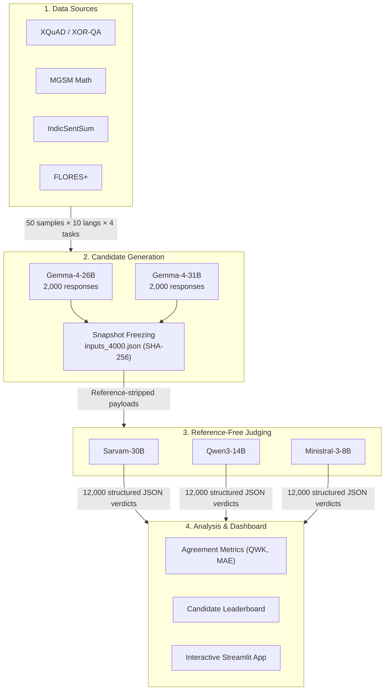

# IndicJudge: Multitask Reference-Free LLM-as-a-Judge for Indic Languages

[](https://www.python.org/downloads/)
[](#-supported-languages)
[](#-supported-tasks)
[](#-benchmark-scale)
[](#-citation--acknowledgments)

> **IBM Research Collaboration · 2026**  
> An open, reproducible benchmark evaluating **Gemma-4-26B** vs **Gemma-4-31B** across **10 Indic languages** and **4 task types** using **3 independent LLM judges** — with zero reference answers required.

---

### ⚡ TL;DR: What is IndicJudge?

1. **What it does:** Evaluates large language model responses across 10 Indic languages without gold-standard reference answers, using task-grounded rubrics (0–5 scale) scored by three independent LLMs (**Sarvam-30B**, **Qwen3-14B**, and **Ministral-3-8B**).
2. **Why reference-free?** Gold answers in Indic scripts are scarce, often biased toward English phrasing, and penalize natural dialectal variation. IndicJudge scores solely against the input evidence.
3. **Key Finding:** **Gemma-4-31B** beats 26B most clearly in multi-step math reasoning (+1.5% gain), while summarization is scale-invariant (~3.9 score for both). The judges agree with each other on **93–98%** of responses within $\pm 1$ point.

---

## 📌 Table of Contents

- [Key Results & Findings](#-key-results--findings)
- [Benchmark Scale](#-benchmark-scale)
- [Supported Languages](#-supported-languages)
- [Supported Tasks](#-supported-tasks)
- [Multitask Pipeline Architecture](#-multitask-pipeline-architecture)
- [How Multitask Scoring Works (5 Stages)](#-how-multitask-scoring-works-5-stages)
- [Four-Task Scoring Rubrics](#-four-task-scoring-rubrics)
- [Controlled Perturbations Experiment (PT1–PT4)](#-controlled-perturbations-experiment-pt1pt4)
- [Quickstart: How to Run](#-quickstart-how-to-run)
- [Interactive Dashboard & Analysis](#-interactive-dashboard--analysis)
- [Repository Directory Structure](#-repository-directory-structure)
- [Presentation Slides](#-presentation-slides)
- [FAQ](#-frequently-asked-questions-faq)
- [Citation & Acknowledgments](#-citation--acknowledgments)

---

## 📊 Key Results & Findings

### 1. Candidate Comparison: Gemma-26B vs Gemma-31B (Mean Score / 5.0)

| Task Type | Gemma-4-26B | Gemma-4-31B | Difference ($\Delta$) | Key Takeaway |
|---|:---:|:---:|:---:|---|
| **Overall Average** | 4.17 | **4.19** | `+0.02` | Consistent modest advantage for 31B |
| **Reasoning (MGSM)** | 4.39 | **4.46** | `+0.07` (+1.5%) | **Largest gain:** Multi-step derivation improved |
| **Translation (FLORES+)** | 4.25 | **4.30** | `+0.05` | Noticeably better phrasing & fluency |
| **Question Answering (QA)** | 4.12 | 4.12 | `0.00` | Identical factual extraction capability |
| **Summarization** | **3.93** | 3.89 | `-0.04` | Scale didn't help; compression bottleneck |

### 2. Judge Behavior & Calibration

| Judge Model | Mean Score | Behavior Profile | Spread & Agreement |
|---|:---:|---|---|
| **Sarvam-30B** | **4.18 / 5.0** | **Calibrated & Balanced** | Uses the full 0–5 range; 93.4% within $\pm 1$ of Qwen |
| **Qwen3-14B** | **4.45 / 5.0** | **Lenient** | Over 50% of ratings are 5/5; highly optimistic |
| **Ministral-3-8B** | **4.03 / 5.0** | **Concentrated** | 94% of ratings clustered at score 4; conservative |

*Inter-judge agreement: **93% to 98%** of judgments across all 10 languages agree within $\pm 1$ point.*

---

## 📐 Benchmark Scale

```text
┌─────────────────────────────────────────────────────────────────────────────────┐
│  10 Indic Languages  ×  4 Task Types  ×  50 Samples = 2,000 Unique Prompts      │
│  2,000 Prompts       ×  2 Models (Gemma-26B & 31B)   = 4,000 Candidate Outputs  │
│  4,000 Outputs       ×  3 Independent LLM Judges     = 12,000 Total Judgments   │
└─────────────────────────────────────────────────────────────────────────────────┘
```

- **Candidate Models:** `Gemma-4-26B (Q4_K_M)` & `Gemma-4-31B (Q4_K_M)` (served via `llama.cpp` on NVIDIA RTX A5000)
- **Judge Models:** `Sarvam-30B`, `Qwen3-14B`, `Ministral-3-8B-Reasoning`
- **Output:** Validated JSON: `{"overall_score": 0–5, "justification": "2-4 sentence explanation"}`

---

## 🌐 Supported Languages

IndicJudge covers 10 major Indic languages spanning Indo-Aryan and Dravidian linguistic families:

| Language | Code | Native Script | Family | Primary Benchmark Sources |
|---|:---:|---|---|---|
| **Bengali** | `bn` | বাংলা | Indo-Aryan | XQuAD, MGSM, IndicSentSum, FLORES+ |
| **Gujarati** | `gu` | ગુજરાતી | Indo-Aryan | XQuAD, MGSM, IndicSentSum, FLORES+ |
| **Hindi** | `hi` | हिन्दी (Devanagari) | Indo-Aryan | XQuAD, MGSM, IndicSentSum, FLORES+ |
| **Kannada** | `kn` | ಕನ್ನಡ | Dravidian | XOR-QA, MGSM, IndicSentSum, FLORES+ |
| **Malayalam** | `ml` | മലയാളം | Dravidian | XOR-QA, MGSM, IndicSentSum, FLORES+ |
| **Marathi** | `mr` | मराठी (Devanagari) | Indo-Aryan | XOR-QA, MGSM, IndicSentSum, FLORES+ |
| **Odia** | `or` | ଓଡ଼ିଆ | Indo-Aryan | XOR-QA, MGSM, IndicSentSum, FLORES+ |
| **Punjabi** | `pa` | ਪੰਜਾਬੀ (Gurmukhi) | Indo-Aryan | XOR-QA, MGSM, IndicSentSum, FLORES+ |
| **Tamil** | `ta` | தமிழ் | Dravidian | XQuAD, MGSM, IndicSentSum, FLORES+ |
| **Telugu** | `te` | తెలుగు | Dravidian | XOR-QA, MGSM, IndicSentSum, FLORES+ |

---

## 🎯 Supported Tasks

| Task | What the Judge Receives | What the Judge Evaluates |
|---|---|---|
| **📝 Question Answering** | Context passage, question, visible response | Correctness, relevance, and sufficiency supported *only* by context. |
| **🧠 Reasoning** | Premise, causal question, options, candidate reasoning & response | Valid mathematical/causal steps and logical flow. Arithmetic slips alone do not lower score. |
| **📄 Summarization** | Source document, visible summary | Faithfulness to source, central coverage, conciseness. |
| **🌐 Translation** | Source text, direction (Indic ↔ English), visible translation | Meaning preservation, completeness, and natural target fluency. |

> **Strict Reference Exclusion:** No dataset answer key, gold summary, or reference translation is ever transmitted to the judges.

---

## 🏗 Multitask Pipeline Architecture

The benchmark runs in an automated, verifiable pipeline:



---

## 🔄 How Multitask Scoring Works (5 Stages)

Every single candidate response passes through the same uniform 5-stage pipeline:

```text
[1. Snapshot Loading] ──► [2. Task Routing] ──► [3. Payload Construction] ──► [4. Judge Inference] ──► [5. Validation & Save]
```

1. **Snapshot Loading:** Reads frozen candidate response from `inputs_4000.json` and verifies its SHA-256 hash.
2. **Task Routing:** Identifies the task type (`qa`, `reasoning`, `summarization`, `translation`) and attaches the matching rubric.
3. **Payload Construction:** Builds the prompt. Strips candidate model identity, internal thinking (for non-reasoning tasks), and dataset reference answers.
4. **Judge Inference:** Sends the request to the LLM judge server with a strict JSON response schema.
5. **Validation & Atomic Save:** Validates that `finish_reason == stop`, score is an integer between `0` and `5`, and justification is $\le 1200$ characters. Appends the row atomically.

---

## 📋 Four-Task Scoring Rubrics

All judges use a shared **0–5 integer scoring scale**:

### General 0–5 Scale Anchor Definitions

| Score | Rating | General Standard |
|:---:|:---:|---|
| **5** | **Perfect** | Fully correct, fluent, complete. No meaningful omissions or factual errors. |
| **4** | **Good** | Essentially correct and sufficient; minor phrasing or slight imprecision that does not alter meaning. |
| **3** | **Partial** | Central answer/message is preserved, but substantive secondary error or omission is present. |
| **2** | **Weak** | Some valid progress/information, but central approach is wrong or major propositions missing. |
| **1** | **Very Poor** | Almost entirely incorrect; only isolated fragments survive; fails to make meaningful progress. |
| **0** | **Fail** | Blank, refusal to answer, incomprehensible nonsense, or complete hallucination. |

---

### Task-Specific Scoring Focus

```text
┌─────────────────────────────────────────────────────────────────────────────────────────────┐
│ 📝 QA Rubric: Context-Bounded Correctness                                                  │
│   • Judge against context ONLY. Do not reward external facts.                               │
│   • A short answer is sufficient if no explanation was requested.                           │
├─────────────────────────────────────────────────────────────────────────────────────────────┤
│ 🧠 Reasoning Rubric: Structural vs. Arithmetic Distinction                                 │
│   • Structural Error: Invalid operations, wrong grouping, or broken deduction (penalized).   │
│   • Arithmetic Error: E.g., choosing 4 × 6 = 22 is an arithmetic execution error ONLY;       │
│     if the formula and steps are sound, arithmetic slips alone DO NOT lower the score!     │
├─────────────────────────────────────────────────────────────────────────────────────────────┤
│ 📄 Summarization Rubric: Faithfulness & Conciseness                                         │
│   • Judge against source document only. Nonessential omission is expected, not an error.   │
│   • Source and summary may use different languages.                                         │
├─────────────────────────────────────────────────────────────────────────────────────────────┤
│ 🌐 Translation Rubric: Meaning Preservation & Fluency                                       │
│   • Compares translation directly against source text.                                      │
│   • Evaluates meaning, completeness, tone, and target-language fluency.                     │
└─────────────────────────────────────────────────────────────────────────────────────────────┘
```

---

## 🧪 Controlled Perturbations Experiment (PT1–PT4)

To empirically verify whether the rubric and judges genuinely respond to reasoning quality (rather than surface fluency or length), we injected 4 controlled error conditions into reasoning prompts:

| Condition | Injected Defect | Target Reasoning Quality | Observed Judge Response |
|---|---|:---:|---|
| **PT1** | **Calculation Error** (partial reasoning, wrong arithmetic carried forward) | **2** | Judges detect arithmetic errors but maintain partial credit if logic holds |
| **PT2** | **Major Logical Gap** (correct setup, omitted critical derivation) | **2** | Judges accurately penalize missing derivation steps |
| **PT3** | **Weak Justification** (correct final answer with weak explanation) | **2–3** | Judges recognize unsupported answers and refuse to grant automatic 5/5 |
| **PT4** | **Minor Reasoning Flaw** (mostly sound method with 1 localized slip) | **3** | Calibrated to 3/5 across Indic languages |

---

## 🚀 Quickstart: How to Run

### 1. Setup Environment
```bash
git clone https://github.com/avijit004/IndicJudge_IBM_LLM.git
cd IndicJudge_IBM_LLM

# Python 3.10+ recommended
python3 -m venv .venv
source .venv/bin/activate
pip install -r Experiments/multitask/judges/requirements.txt
```

### 2. Verify Candidate Responses & Integrity
```bash
# Verify all 4,000 candidate outputs (2,000 for Gemma-26B and 2,000 for Gemma-31B)
python3 run.py candidates

# Run offline data, payload, and checkpoint verification (no GPU needed)
python3 run.py check

# Check current run status across languages and tasks
python3 run.py status
```

### 3. Run Judges
Launch your judge servers (vLLM, llama.cpp, or HuggingFace TGI) and point the environment variables to their OpenAI-compatible endpoints:

```bash
# Configure judge endpoints
export RF_SARVAM_API_URL="http://HOST:PORT/v1/chat/completions"
export RF_QWEN_API_URL="http://HOST:PORT/v1/chat/completions"
export RF_MINISTRAL_API_URL="http://HOST:PORT/v1/chat/completions"

# Run judges (resumable: saved judgments are automatically skipped)
python3 run.py judge sarvam
python3 run.py judge qwen
python3 run.py judge ministral

# Or run all sequentially
python3 run.py judge all
```

---

## 📈 Interactive Dashboard & Analysis

Analyze agreement, compute bootstrap confidence intervals, and explore score distributions:

```bash
# Generate statistical analysis exports (MAE, QWK, candidate score ranks)
python3 run.py analyze

# Install dashboard requirements and start Streamlit app
pip install -r Experiments/multitask/judges/requirements-dashboard.txt
python3 run.py dashboard
```

Open your browser at `http://localhost:8501` to view interactive heatmaps, radar charts, and per-language score breakdowns.

---

## 📂 Repository Directory Structure

```text
IndicJudge_IBM/
├── run.py                                    # Central runner for candidate checks, judging, and analysis
├── requirements.txt                          # Top-level dependencies
├── README.md                                 # Project documentation
│
├── Experiments/
│   ├── multitask/                            # 4-task reference-free benchmark (Current Run)
│   │   ├── candidate/                        # 4,000 candidate responses
│   │   │   ├── gemma26b_responses.csv        # 2,000 Gemma-4-26B responses
│   │   │   └── gemma31b_responses.csv        # 2,000 Gemma-4-31B responses
│   │   ├── judges/                           # Judging engine, rubrics, metrics & dashboard
│   │   │   ├── rubric.py                     # All 4 task rubrics & system prompts
│   │   │   ├── judge.py                      # Core judge execution and parsing
│   │   │   ├── analyze.py                    # Metrics, QWK, MAE & bootstrap CIs
│   │   │   ├── dashboard.py                  # Streamlit interactive UI
│   │   │   ├── data/inputs_4000.json         # Frozen, reference-stripped items (SHA-256)
│   │   │   └── outputs/judges_4000/          # 12,000 saved judgments
│   │   └── run.py                            # Multitask experiment script
│   │
│   └── mathematics/                          # Math reasoning & perturbation experiments
│       ├── gsm_*_experiment/                 # Per-language GSM generation scripts
│       ├── mgsm_*_experiment/                # Per-language MGSM generation scripts
│       ├── perturbation_experiment/          # Controlled error injections (PT1–PT4)
│       ├── sarvam_30b_judge/                 # Sarvam Initial Rubric
│       ├── qwen3_14b_judge/                  # Qwen Initial Rubric
│       ├── ministral_8b_judge/               # Ministral Initial Rubric
│       ├── sarvam_reasoning_judge/           # Sarvam Rubric v2 (structural vs execution)
│       ├── qwen_reasoning_judge/             # Qwen Rubric v2
│       └── ministral_reasoning_judge/        # Ministral Rubric v2
│
├── Dataset/                                  # 22-language raw & normalized datasets
│   ├── dataset_csv/                          # Clean CSVs per task (qa, reasoning, summarization, translation)
│   ├── config/sources.py                     # HuggingFace source dataset adapters
│   └── scripts/                              # Verification and collection scripts
│
└── docs/                                     # Reference papers (JudgeBench) and research plan
```

---

## 📽 Presentation Slides

The presentation slide deck is available at:  
👉 **[`IndicJudge_Presentation_Final.pptx`](file:///Users/avijit/Desktop/IndicJudge_IBM/IndicJudge_Presentation_Final.pptx)**

- **Slide 1–3:** Motivation, dataset overview, and architecture pipeline
- **Slide 4–5:** Multitask Architecture & 5-stage Scoring Flow
- **Slide 6–10:** Full task rubrics (QA, Reasoning, Summarization, Translation)
- **Slide 11–13:** Scale, Results & Findings across candidate models and judges
- **Slide 14–17:** Controlled perturbation experiments (PT1–PT4) with real Indic responses

---

## 💡 Frequently Asked Questions (FAQ)

<details>
<summary><b>Q1: Can I evaluate my own candidate model with IndicJudge?</b></summary>
<p>
Yes! Generate responses following the JSON schema in <code>inputs_4000.json</code> with fields <code>{"sample_id", "task", "language_code", "candidate_response"}</code>. Then run <code>python3 run.py judge <judge_name></code> against your response file.
</p>
</details>

<details>
<summary><b>Q2: Why not just translate English gold answers into Indic languages?</b></summary>
<p>
Machine translation of English references frequently introduces unnatural phrasing, loses domain nuance, or enforces literal word choices that do not reflect native Indic usage. Reference-free judging evaluates the candidate's output against the ground-truth context/document directly.
</p>
</details>

<details>
<summary><b>Q3: What happens if a judge returns malformed JSON or truncates output?</b></summary>
<p>
The validation engine rejects truncated or unparseable outputs. They are recorded in error logs rather than being saved as <code>0</code>, preventing artificial distortion of candidate scores.
</p>
</details>

---

## 🤝 Citation & Acknowledgments

This research was conducted in collaboration with **IBM Research** (2026).

```bibtex
@misc{indicjudge2026,
  title={IndicJudge: Multitask Reference-Free Evaluation across 10 Indic Languages},
  author={IndicJudge Collaboration Team},
  year={2026},
  publisher={GitHub},
  howpublished={\url{https://github.com/avijit004/IndicJudge_IBM_LLM}}
}
```
