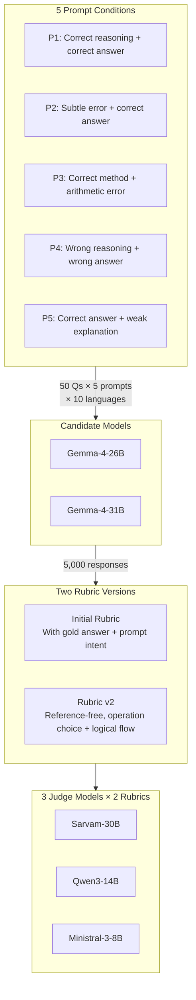

# IndicJudge

IndicJudge evaluates Gemma-4-26B and Gemma-4-31B responses with Sarvam-30B, Qwen3-14B and Ministral 3 8B Reasoning.

**Current evaluation:** 2,000 matched inputs, 4,000 candidate responses, ten languages and four tasks. Both models have 50 responses per language/task. The two failed input pairs were replaced with unused row-51 samples; the original files remain preserved.

## Evaluation pipeline


## Evaluation matrix


> **Scale:** 4 tasks × 10 languages × 50 samples = 2,000 inputs → 4,000 candidate responses → 12,000 total judgments.

## Math experiment flow (P1–P5)



## Start here

| What you need                               | Location                                                                        |
| ------------------------------------------- | ------------------------------------------------------------------------------- |
| All 2,000 Gemma26B responses                | [gemma26b_responses.csv](Experiments/multitask/candidate/gemma26b_responses.csv) |
| All 2,000 Gemma31B responses                | [gemma31b_responses.csv](Experiments/multitask/candidate/gemma31b_responses.csv) |
| Current reference-free judging instructions | [Reference-free README](Experiments/multitask/judges/README.md)                  |
| Judge prompts and four task rubrics         | [rubric.py](Experiments/multitask/judges/rubric.py)                              |
| Evaluation and leaderboard design           | [Research plan](Experiments/multitask/judges/RESEARCH_PLAN.md)                   |
| All multitask experiments                   | [Multitask folder guide](Experiments/multitask/README.md)                        |
| Earlier math experiments and both rubrics   | [Mathematics folder guide](Experiments/mathematics/README.md)                    |
| Dataset descriptions                        | [Dataset README](Dataset/README.md)                                              |

## Folder layout

```text
IndicJudge_IBM/
├── run.py                        # Short commands for the current 4,000-response run.
├── requirements.txt              # Server-side model-generation dependencies (PyTorch, Transformers).
├── Experiments/
│   ├── multitask/                # Four-task evaluation across 10 Indic languages.
│   │   ├── candidate/           # Two complete 2,000-response CSVs and generation history.
│   │   └── judges/              # Three reference-free judges, results, analysis and dashboard.
│   └── mathematics/              # P1–P5 math experiments, both rubrics and human review.
│       ├── gsm_*_experiment/     # Per-language candidate generation (GSM questions).
│       ├── mgsm_*_experiment/    # Per-language candidate generation (MGSM questions).
│       ├── sarvam_30b_judge/     # Initial Rubric: answer correctness, reasoning, prompt compliance.
│       ├── qwen3_14b_judge/      # Initial Rubric judge.
│       ├── ministral_8b_judge/   # Initial Rubric judge.
│       ├── sarvam_reasoning_judge/ # Rubric v2: reference-free operation choice and logical flow.
│       ├── qwen_reasoning_judge/ # Rubric v2 judge.
│       ├── ministral_reasoning_judge/ # Rubric v2 judge.
│       ├── human_evaluation/     # Reviewer workbooks and reading pack.
│       ├── perturbation_experiment/ # Additional prompts with targeted reasoning flaws.
│       └── judge_experiment/     # Earlier Bengali/Telugu judging trials.
├── Dataset/                      # Original dataset files, task CSVs and coverage spreadsheets.
└── docs/                         # JudgeBench paper and folder-move record.
```

The ten languages are Bengali, Gujarati, Hindi, Kannada, Malayalam, Marathi, Odia, Punjabi, Tamil and Telugu.

## Run the current evaluation

Run from this project folder using a Python environment with the dependencies below:

```bash
python3 -m pip install -r Experiments/multitask/judges/requirements.txt

python3 run.py candidates
python3 run.py check
python3 run.py status --detail
```

Load each judge separately on the GPU server. Set its actual endpoint on the Mac where you run the scripts:

```bash
# Example only: Ministral must actually be running at this endpoint.
export RF_MINISTRAL_API_URL="http://172.30.1.83:33937/v1/chat/completions"
caffeinate -i python3 run.py judge ministral
```

Use `python3 run.py judge qwen` and `python3 run.py judge sarvam` after setting `RF_QWEN_API_URL` and `RF_SARVAM_API_URL`. Use `judge all` only if all three model servers are available. On Linux omit `caffeinate -i`.

These short commands automatically use **`data/inputs_4000.json`** and **`outputs/judges_4000/`** inside the reference-free folder. They do not use the older 3,998-response snapshot. Valid saved judgments are skipped when resumed. Each judge targets 4,000 responses, or 12,000 judgments in total. Results are saved on the machine running Python, even when inference happens on the server.

```bash
python3 run.py analyze

# Optional dashboard for the current 4,000-response analysis:
python3 -m pip install -r Experiments/multitask/judges/requirements-dashboard.txt
python3 run.py dashboard
```

The dashboard reads `analysis_4000/`. Re-run analysis to refresh its data. Judge-quality rankings require independent adjudicated human scores; agreement alone cannot identify the best judge. See the research plan for MAE, quadratic weighted kappa, matched comparisons and uncertainty estimates.

## Four-task evaluation and references

| Task               | What reference-free judges receive                                          | What they assess                                  |
| ------------------ | --------------------------------------------------------------------------- | ------------------------------------------------- |
| Question answering | Context, question and visible response                                      | Correctness and sufficiency supported by context. |
| Reasoning          | Premise, causal question, options, candidate reasoning and visible response | Appropriate choices and logical justification.    |
| Summarization      | Source document and visible summary                                         | Faithfulness, central coverage and conciseness.   |
| Translation        | Source text, language direction and visible translation                     | Meaning preservation, completeness and fluency.   |

No dataset answer, correct-option label, reference summary or reference translation is sent to the current judges. Each returns one 0–5 overall score and a justification. Candidate generation also receives no gold references. Selected translation pairs are Indic-to-English; reasoning uses causal commonsense questions.

Earlier multitask runs supplied references for QA and translation. Their results remain in separate folders and are not reused as current reference-free judgments.

## Mathematical reasoning: P1–P5

Each language has 50 questions. Both candidate models answer every question under five prompt conditions:

**50 questions × 5 prompts × 2 models × 10 languages = 5,000 candidate responses.**

| Prompt | Requested behavior                                                                                    |
| ------ | ----------------------------------------------------------------------------------------------------- |
| P1     | Correct step-by-step reasoning, correct calculations and a verified final answer.                     |
| P2     | A subtle logical or mathematical error in the reasoning, while still giving the correct final answer. |
| P3     | A correct method with a small arithmetic error at the end, producing an incorrect final answer.       |
| P4     | Incorrect reasoning or invalid mathematical steps and an incorrect final answer.                      |
| P5     | A correct final answer with a brief explanation that does not fully justify it.                       |

These are generation instructions, not guaranteed properties of the responses. Judges evaluate what each candidate actually produced.

### Initial Rubric

The judge receives the problem, reference numerical answer, candidate solution, original generation prompt and prompt-intent summary. It returns:

- `answer_correct`: whether the visible final answer matches the supplied reference.
- `reasoning_quality`: a score from 0–5 for mathematical reasoning.
- `follows_prompt_intent`: whether the response satisfies the original prompt.
- `justification`: a short explanation.

The supplied reference is authoritative for answer correctness. Reasoning quality considers both internal reasoning and the visible response.

### Rubric Version 2

The judge receives only the problem, candidate solution and prompt number. **No gold answer or original generation prompt is supplied.** The prompt number is an identifier, not a scoring instruction.

The judge evaluates operation choice and logical flow together. Arithmetic execution errors alone do not lower the score. For example, choosing addition when multiplication is required is a structural error; writing `6 × 4 = 22` is an arithmetic error.

| Score | Meaning                                                                                                |
| ----- | ------------------------------------------------------------------------------------------------------ |
| 0     | No assessable solution method.                                                                         |
| 1     | A method is attempted, but it makes no valid progress.                                                 |
| 2     | Major structural problems, a missing central relationship, or multiple independent repairs are needed. |
| 3     | One localized structural error or missing essential step.                                              |
| 4     | A valid method with a minor clarity omission.                                                          |
| 5     | A complete, justified method with appropriate operations and logical dependencies.                     |

Output includes `operator_choice`, `overall_score` and `justification`. The operator label is `correct`, `partially_correct`, `incorrect` or `not_assessable`; it has no separate numerical weight.

Each rubric targets 5,000 judgments per judge. Results from the two rubrics stay in separate folders.

## Paths after reorganization

All experiment folders now live under `Experiments/`. Old commands that referenced top-level directories like `reference_free_judge/`, `multitask_50_samples/`, or any `gsm_*_experiment/` folder must be updated to use the new paths. Prefer `python3 run.py` for the active evaluation.

Only this local project was reorganized. Existing server directories and server model-loading commands were not changed. If syncing to a server, copy the new layout before using the new paths there. Folder moves and verified data hashes are recorded in [organization_manifest.json](docs/organization_manifest.json).
