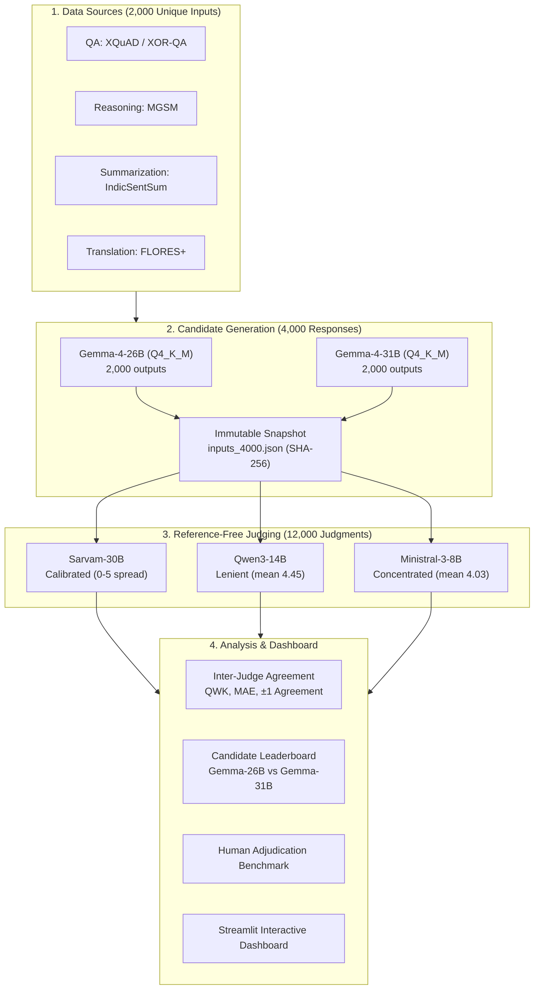

# IndicJudge: Multitask Reference-Free LLM-as-a-Judge for Indic Languages

[](https://www.python.org/downloads/)
[](#supported-languages)
[](#supported-tasks)
[](#benchmark-scale)
[](#citation--acknowledgments)

**IndicJudge** is an end-to-end framework for evaluating Large Language Models across diverse Indic languages without requiring human reference (gold-standard) answers. 

By employing three independent LLM judges with task-specific 0–5 rubrics, IndicJudge benchmarks candidate models (**Gemma-4-26B** vs **Gemma-4-31B**) across **10 Indic languages** and **4 task types**, producing **4,000 candidate responses** and **12,000 reference-free judgments**.

---

## 📌 Table of Contents

- [Overview & Why Reference-Free?](#-overview--why-reference-free)
- [Benchmark Scale](#-benchmark-scale)
- [Supported Languages](#-supported-languages)
- [Supported Tasks](#-supported-tasks)
- [Evaluation Architecture](#-evaluation-architecture)
- [Four-Task Scoring Rubrics (0–5 Scale)](#-four-task-scoring-rubrics-05-scale)
- [Quickstart: How to Run](#-quickstart-how-to-run)
- [Dashboard & Analysis](#-dashboard--analysis)
- [Repository Structure](#-repository-structure)
- [Presentations & Artifacts](#-presentations--artifacts)
- [Citation & Acknowledgments](#-citation--acknowledgments)

---

## 💡 Overview & Why Reference-Free?

Traditional LLM evaluation relies heavily on exact matches against English or translated reference answers. In low-resource and linguistically diverse Indic languages, reference answers are often:
1. **Unobtainable or scarce** across specialized regional domains.
2. **Brittle**, as valid dialectal variations and alternate phrasing are unfairly penalized.
3. **Mismatched**, where candidate answers are in Indic scripts while references are in English.

**IndicJudge solves this by using task-grounded, reference-free judging:**
- Judges evaluate responses using **only the input evidence** (context, premise, document, source text) and a structured **0–5 rubric**.
- Candidate model identity and reasoning traces are decoupled to prevent scoring contamination.
- Multiple independent judge architectures (**Sarvam-30B**, **Qwen3-14B**, **Ministral-3-8B**) are cross-validated using Quadratic Weighted Kappa (QWK) and Mean Absolute Error (MAE).

---

## 📊 Benchmark Scale

```text
┌─────────────────────────────────────────────────────────────────────────────┐
│ 10 Indic Languages  ×  4 Task Types  ×  50 Samples = 2,000 Unique Inputs    │
│ 2,000 Inputs  ×  2 Candidate Models (26B & 31B)   = 4,000 Candidate Outputs│
│ 4,000 Outputs ×  3 Independent LLM Judges         = 12,000 Judgments       │
└─────────────────────────────────────────────────────────────────────────────┘
```

- **Candidate Models:** `Gemma-4-26B (Q4_K_M)` and `Gemma-4-31B (Q4_K_M)`
- **Judge Models:** `Sarvam-30B`, `Qwen3-14B`, `Ministral-3-8B-Reasoning`
- **Output Format:** Strict JSON: `{"overall_score": 0–5, "justification": "..."}`

---

## 🌐 Supported Languages

IndicJudge covers 10 major Indic languages spanning Indo-Aryan and Dravidian language families:

| Language | ISO Code | Script | Family |
|---|:---:|---|---|
| **Bengali** | `bn` | Bengali | Indo-Aryan |
| **Gujarati** | `gu` | Gujarati | Indo-Aryan |
| **Hindi** | `hi` | Devanagari | Indo-Aryan |
| **Kannada** | `kn` | Kannada | Dravidian |
| **Malayalam** | `ml` | Malayalam | Dravidian |
| **Marathi** | `mr` | Devanagari | Indo-Aryan |
| **Odia** | `or` | Odia | Indo-Aryan |
| **Punjabi** | `pa` | Gurmukhi | Indo-Aryan |
| **Tamil** | `ta` | Tamil | Dravidian |
| **Telugu** | `te` | Telugu | Dravidian |

---

## 🎯 Supported Tasks

| Task | Benchmark Source | What the Judge Receives | Evaluation Focus |
|---|---|---|---|
| **Question Answering (QA)** | XQuAD / XOR-QA | Context passage, question, visible response | Factual correctness and sufficiency from context |
| **Reasoning** | MGSM / COPA-style | Premise, options, candidate reasoning & response | Method, deduction, operations & logical flow |
| **Summarization** | IndicSentSum | Source document, visible summary | Faithfulness, core coverage & conciseness |
| **Translation** | FLORES+ | Source text, language direction, translation | Meaning preservation, completeness & fluency |

---

## 🏗 Evaluation Architecture



---

## 📏 Four-Task Scoring Rubrics (0–5 Scale)

Each judge receives only the task inputs and candidate visible response (no gold answers). Scores range from **0 to 5**:

| Score | Meaning | General Description |
|:---:|---|---|
| **5** | **Perfect** | Fully correct, faithful, complete, and fluent. No meaningful errors or unsupported claims. |
| **4** | **Good** | Essentially correct and sufficient; minor imprecision, phrasing, or slight clarity issue. |
| **3** | **Partial** | Central answer or core message is preserved, but substantive secondary error or omission exists. |
| **2** | **Weak** | Some valid progress/information, but central approach is flawed or key parts are wrong. |
| **1** | **Very Poor** | Largely incorrect, misleading, or fails to make valid progress. |
| **0** | **Fail** | Blank, refusal to answer, unrelated output, or complete hallucination. |

### 🔍 Special Reasoning Task Rubric (Structural vs Arithmetic Errors)
In mathematical reasoning, IndicJudge separates **logical methodology** from simple arithmetic execution:
- **Structural Error:** Choosing addition instead of multiplication, missing essential steps, or inverted logic (lowers the score).
- **Arithmetic Execution Error:** Choosing the correct formula $4 \times 6$ but computing $22$ (does **not** lower the score, as long as the method and logical flow are sound).

---

## 🚀 Quickstart: How to Run

### 1. Prerequisites & Setup
Clone the repository and set up a Python environment:

```bash
git clone https://github.com/avijit004/IndicJudge_IBM_LLM.git
cd IndicJudge_IBM_LLM

# Create and activate a virtual environment
python3 -m venv .venv
source .venv/bin/activate

# Install judging dependencies
pip install -r Experiments/multitask/judges/requirements.txt
```

### 2. Verify Candidate Responses & Integrity
Check that all 4,000 candidate responses and data snapshots are intact:

```bash
# Verify candidate CSV counts (2,000 each for Gemma-26B and Gemma-31B)
python3 run.py candidates

# Run offline data, payload, and checkpoint verification
python3 run.py check

# Check execution status across all tasks and languages
python3 run.py status
```

### 3. Run Reference-Free Judges
Each judge connects to an OpenAI-compatible endpoint (e.g. hosted via `vLLM` or `llama.cpp`):

```bash
# Set your judge endpoint URLs
export RF_SARVAM_API_URL="http://<HOST>:<PORT>/v1/chat/completions"
export RF_QWEN_API_URL="http://<HOST>:<PORT>/v1/chat/completions"
export RF_MINISTRAL_API_URL="http://<HOST>:<PORT>/v1/chat/completions"

# Run an individual judge
python3 run.py judge sarvam
python3 run.py judge qwen
python3 run.py judge ministral

# Or run all three sequentially (if all endpoints are active)
python3 run.py judge all
```

---

## 📈 Dashboard & Analysis

Compute agreement statistics, candidate score rankings, and bootstrap confidence intervals:

```bash
# Compute metrics and generate CSV summaries
python3 run.py analyze

# Install dashboard requirements and launch the interactive UI
pip install -r Experiments/multitask/judges/requirements-dashboard.txt
python3 run.py dashboard
```

The Streamlit dashboard allows interactive filtering by **language**, **task**, and **judge**, showing score distributions, inter-judge agreement heatmaps, and pairwise model comparisons.

---

## 📂 Repository Structure

```text
IndicJudge_IBM/
├── run.py                                    # Unified CLI runner for candidate checks, judging, and analysis
├── requirements.txt                          # Generation dependencies (PyTorch, Transformers, llama.cpp)
│
├── Experiments/
│   ├── multitask/                            # Active 4,000-response multitask benchmark
│   │   ├── candidate/                        # 2,000-response CSVs for Gemma-26B & Gemma-31B
│   │   │   ├── gemma26b_responses.csv
│   │   │   └── gemma31b_responses.csv
│   │   ├── judges/                           # Judging engine, rubrics, analysis & dashboard
│   │   │   ├── rubric.py                     # All 4 task rubrics & system prompts
│   │   │   ├── judge.py                      # Core judge execution and parsing
│   │   │   ├── analyze.py                    # Metrics, QWK, MAE & bootstrap CIs
│   │   │   ├── dashboard.py                  # Streamlit visual dashboard
│   │   │   ├── data/inputs_4000.json         # Frozen, reference-stripped evaluation items
│   │   │   └── outputs/judges_4000/          # Saved judgments for Sarvam, Qwen, Ministral
│   │   └── review_human/                     # Double-blind human adjudication pack
│   │
│   └── mathematics/                          # Math reasoning & perturbation experiments (P1–P5)
│       ├── gsm_*_experiment/                 # Per-language GSM generation scripts & data
│       ├── mgsm_*_experiment/                # Per-language MGSM generation scripts & data
│       ├── perturbation_experiment/          # Controlled error injections (PT1–PT4)
│       ├── sarvam_30b_judge/                 # Sarvam Initial Rubric results
│       ├── qwen3_14b_judge/                  # Qwen Initial Rubric results
│       ├── ministral_8b_judge/               # Ministral Initial Rubric results
│       ├── sarvam_reasoning_judge/           # Sarvam Rubric v2 (structural vs arithmetic)
│       ├── qwen_reasoning_judge/             # Qwen Rubric v2
│       └── ministral_reasoning_judge/        # Ministral Rubric v2
│
├── Dataset/                                  # 22-language raw & normalized benchmark collections
│   ├── dataset_csv/                          # Clean CSVs per task (qa, reasoning, summarization, translation)
│   ├── config/sources.py                     # HuggingFace source dataset adapters
│   └── scripts/                              # Verification and collection scripts
│
└── docs/                                     # Reference papers (JudgeBench) and design notes
```

---

## 🖥 Presentations & Artifacts

- **`IndicJudge_Presentation_Final.pptx`**: Presentation slide deck covering:
  - Multitask evaluation overview and rationale
  - Two-phase candidate generation and reference-free judging architecture
  - Detailed task rubric slides for QA, Reasoning, Summarization, and Translation
  - Results breakdown across models and languages
  - Controlled perturbation experiment (PT1–PT4) findings

---

## 🤝 Citation & Acknowledgments

This research is conducted in collaboration with **IBM Research** (2026).

If you use IndicJudge in your research, please cite:

```bibtex
@misc{indicjudge2026,
  title={IndicJudge: Multitask Reference-Free Evaluation across 10 Indic Languages},
  author={IndicJudge Collaboration Team},
  year={2026},
  publisher={GitHub},
  howpublished={\url{https://github.com/avijit004/IndicJudge_IBM_LLM}}
}
```
